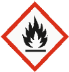
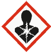
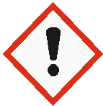
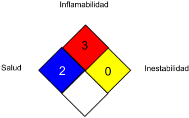
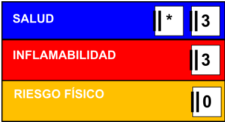

<!-- doc_id: fds069-esmalte-uretano-part-a-sika -->
<!-- archivo_original: FDS 69 - Esmalte Uretano Part A - SIKA.pdf -->

<!-- pagina: 1 -->
## FICHA DE DATOS DE SEGURIDAD

## Esmalte Uretano Part A

Versión 4.0

Número de HDS: 000000613420

Fecha de revisión: 2023/09/30

## SECCIÓN 1. IDENTIFICACIÓN DE LA SUSTANCIA QUÍMICA PELIGROSA O MEZCLA Y DEL PROVEEDOR O FABRICANTE

Nombre del producto

: Esmalte Uretano Part A

## Informaciones sobre el fabricante o el proveedor

Compañía

Teléfono

: Sika Colombia S.A.S. Vereda Canavita km 20,5 Autopista Norte Tocancipá, Cundinamarca Colombia

: (57-1) 8786333

Teléfono de emergencia

Dirección de correo electróni-

co

Fax

: CISPROQUIM Bogotá: 2886012 / 2886355 Resto del país: 01 8000 916012

: controlcalidad.lab@co.sika.com

: (57-1) 8786660

## Uso recomendado del producto químico y restricciones de uso

Uso del producto

: Protección de Corrosión

## SECCIÓN 2. IDENTIFICACIÓN DE LOS PELIGROS

## Clasificación según SGA (GHS)

Líquidos Inflamables

: Categoría 3

Corrosión/irritación cutáneas : Categoría 3

Sensibilización cutánea

: Categoría 1

Toxicidad a la reproducción : Categoría 2

Toxicidad sistémica específica de órganos blanco - exposición única

Toxicidad sistémica específica de órganos blanco - Exposiciones repetidas (Inhalación)

Peligro de aspiración

: Categoría 3 (Sistema nervioso central)

: Categoría 2

: Categoría 1

Peligro a corto plazo (agudo) para el medio ambiente acuá-

tico

Peligro a largo plazo (crónico)

para el medio ambiente acuá-

: Categoría 3

: Categoría 3

<!-- pagina: 2 -->
## FICHA DE DATOS DE SEGURIDAD

## Esmalte Uretano Part A

Versión 4.0

Número de HDS: 000000613420

Fecha de revisión: 2023/09/30

tico

## Etiqueta SGA (GHS)

| Pictogramas de peligro   | :   |                                                                                                                                                                                                                                                                                                                                                                                                                                                                                                                                                                                                                                                                                                                                                                                                                                                                                                                                                                                                                                                                                                                                                                                                                                                                                                                                                                                                                                                                                                                            |
|--------------------------|-----|----------------------------------------------------------------------------------------------------------------------------------------------------------------------------------------------------------------------------------------------------------------------------------------------------------------------------------------------------------------------------------------------------------------------------------------------------------------------------------------------------------------------------------------------------------------------------------------------------------------------------------------------------------------------------------------------------------------------------------------------------------------------------------------------------------------------------------------------------------------------------------------------------------------------------------------------------------------------------------------------------------------------------------------------------------------------------------------------------------------------------------------------------------------------------------------------------------------------------------------------------------------------------------------------------------------------------------------------------------------------------------------------------------------------------------------------------------------------------------------------------------------------------|
| Palabra de advertencia   | :   | Peligro                                                                                                                                                                                                                                                                                                                                                                                                                                                                                                                                                                                                                                                                                                                                                                                                                                                                                                                                                                                                                                                                                                                                                                                                                                                                                                                                                                                                                                                                                                                    |
| Indicaciones de peligro  | :   | H226 Líquido y vapores inflamables. H304 Puede ser mortal en caso de ingestión y de penetración en las vías respiratorias. H316 Provoca una leve irritación cutánea. H317 Puede provocar una reacción cutánea alérgica. H336 Puede provocar somnolencia o vértigo. H361f Susceptible de perjudicar la fertilidad. H373 Puede provocar daños en los órganos tras exposiciones prolongadas o repetidas por inhalación. H412 Nocivo para los organismos acuáticos, con efectos noci- vos duraderos.                                                                                                                                                                                                                                                                                                                                                                                                                                                                                                                                                                                                                                                                                                                                                                                                                                                                                                                                                                                                                           |
| Consejos de prudencia    | :   | Prevención: P201 Procurarse las instrucciones antes del uso. P202 No manipular antes de haber leído y comprendido todas las precauciones de seguridad. P210 Mantener alejado del calor, chispas, llamas al descubier- to, superficies calientes y otras fuentes de ignición. No fumar. P233 Mantener el recipiente herméticamente cerrado. P240 Toma de tierra y enlace equipotencial del recipiente y del equipo receptor. P241 Utilizar material eléctrico, de ventilación o de iluminación/ antideflagrante. P242 No utilizar herramientas que produzcan chispas. P243 Tomar medidas de precaución contra las descargas elec- trostáticas. P260 No respirar nieblas o vapores. P271 Utilizar sólo al aire libre o en un lugar bien ventilado. P272 La ropa de trabajo contaminada no debe salir del lugar de trabajo. P273 No dispersar en el medio ambiente. P280 Usar guantes/ ropa de protección/ equipo de protección para los ojos/ la cara. Intervención: P301 + P310 EN CASO DE INGESTIÓN: Llamar inmediata- mente a un CENTRO DE TOXICOLOGÍA o a un médico. P303 + P361 + P353 EN CASO DE CONTACTO CON LA PIEL (o el pelo): Quitar inmediatamente toda la ropa contaminada. Enjuagar la piel con agua. P304 + P340 + P312 EN CASO DE INHALACIÓN: Transportar a la persona al aire libre y mantenerla en una posición que le facilite la respiración.Llamar a un CENTRO DE TOXICOLOGÍA/médico/ si la persona se encuentra mal. P308 + P313 EN CASO DE exposición demostrada o supues- ta: consultar a un médico. |

<!-- pagina: 3 -->
## FICHA DE DATOS DE SEGURIDAD

## Esmalte Uretano Part A

Versión 4.0

Número de HDS: 000000613420

Fecha de revisión: 2023/09/30

## Otros peligros no clasificables

No conocidos.

P331 NO provocar el vómito.

P333 + P313 En caso de irritación cutánea o sarpullido: consultar a un médico.

P362 + P364 Quitar la ropa contaminada y lavarla antes de volverla a usar.

P370 + P378 En caso de incendio: Utilizar arena seca, producto químico seco o espuma resistente al alcohol para la extinción.

## Almacenamiento:

P403 + P233 Almacenar en un lugar bien ventilado. Mantener el recipiente herméticamente cerrado.

P403 + P235 Almacenar en un lugar bien ventilado. Mantener fresco.

P405 Guardar bajo llave.

## Eliminación:

P501 Eliminar el contenido/ recipiente en una planta de eliminación de residuos aprobada.

## SECCIÓN 3. COMPOSICIÓN/INFORMACIÓN SOBRE LOS INGREDIENTES

Sustancia / mezcla

: Mezcla

## Componentes

| Nombre químico                                                                                                                                                                                                    | CAS No.     | Concentración (% w/w)   |
|-------------------------------------------------------------------------------------------------------------------------------------------------------------------------------------------------------------------|-------------|-------------------------|
| acetato de n-butilo                                                                                                                                                                                               | 123-86-4    | >= 10 - < 20            |
| Nafta disolvente (petróleo), fracción aromática ligera; nafta de bajo punto de ebullición, sin especificar                                                                                                        | 64742-95-6  | >= 5 - < 10             |
| acetato de 2-metoxi-1-metiletilo                                                                                                                                                                                  | 108-65-6    | >= 5 - < 10             |
| xileno                                                                                                                                                                                                            | 1330-20-7   | >= 2,5 - < 5            |
| acetato de propilo                                                                                                                                                                                                | 109-60-4    | >= 1 - < 5              |
| etilbenceno                                                                                                                                                                                                       | 100-41-4    | >= 1 - < 2,5            |
| sebacato de bis(1,2,2,6,6-pentametil-4- piperidilo)                                                                                                                                                               | 41556-26-7  | >= 0,25 - < 1           |
| Poly(oxy-1,2-ethanediyl), .alpha.-[3-[3-(2H- benzotriazol-2-yl)-5-(1,1-dimethylethyl)-4- hydroxyphenyl]-1-oxopropyl]-.omega.-[3-[3-(2H- benzotriazol-2-yl)-5-(1,1-dimethylethyl)-4- hydroxyphenyl]-1-oxopropoxy]- | 104810-47-1 | >= 0,25 - < 1           |
| Poly(oxy-1,2-ethanediyl), .alpha.-[3-[3-(2H- benzotriazol-2-yl)-5-(1,1-dimethylethyl)-4- hydroxyphenyl]-1-oxopropyl]-.omega.-hydroxy-                                                                             | 104810-48-2 | >= 0,25 - < 1           |
| sebacato de metilo y 1,2,2,6,6-pentametil-4- piperidilo                                                                                                                                                           | 82919-37-7  | >= 0,1 - < 0,25         |
| metacrilato de metilo                                                                                                                                                                                             | 80-62-6     | >= 0,1 - < 0,25         |

## SECCIÓN 4. PRIMEROS AUXILIOS

Consejos generales

: Retire a la persona de la zona peligrosa.

<!-- pagina: 4 -->
## FICHA DE DATOS DE SEGURIDAD

## Esmalte Uretano Part A

| Versión 4.0                                                |    | Número de HDS: 000000613420 Fecha de revisión: Consulte a un médico. Muéstrele esta hoja de seguridad al doctor que esté de servi-                                                                                                                                                                                                                                                                                                                                                                                                                                                                                              |
|------------------------------------------------------------|----|---------------------------------------------------------------------------------------------------------------------------------------------------------------------------------------------------------------------------------------------------------------------------------------------------------------------------------------------------------------------------------------------------------------------------------------------------------------------------------------------------------------------------------------------------------------------------------------------------------------------------------|
| En caso de inhalación                                      | :  | cio. Salga al aire libre. Consultar a un médico después de una exposición importan- te.                                                                                                                                                                                                                                                                                                                                                                                                                                                                                                                                         |
| En caso de contacto con la piel                            | :  | Quítese inmediatamente la ropa y zapatos contaminados. Elimínelo lavando con jabón y mucha agua. Si persisten los síntomas, llame a un médico.                                                                                                                                                                                                                                                                                                                                                                                                                                                                                  |
| En caso de contacto con los ojos                           | :  | Quítese los lentes de contacto. Manténgase el ojo bien abierto mientras se lava. Si persiste la irritación de los ojos, consulte a un especialista.                                                                                                                                                                                                                                                                                                                                                                                                                                                                             |
| En caso de ingestión                                       | :  | Lávese la boca con agua y después beba agua abundante. No provoque vómitos. No dé leche ni bebidas alcohólicas. Nunca debe administrarse nada por la boca a una persona inconsciente. Lleve al afectado enseguida a un hospital.                                                                                                                                                                                                                                                                                                                                                                                                |
| Síntomas y efectos más im- portante, agudos y retarda- dos | :  | Puede ser mortal en caso de ingestión y de penetración en las vías respiratorias. Provoca una leve irritación cutánea. Puede provocar una reacción cutánea alérgica. Puede provocar somnolencia o vértigo. Susceptible de perjudicar la fertilidad. Puede provocar daños en los órganos tras exposiciones pro- longadas o repetidas por inhalación. Riesgo de lesiones pulmonares graves (por aspiración). efectos sensibilizantes Su inhalación puede causar edema pulmonar y neumonía. Reacciones alérgicas Falta de coordinación Vértigo Vea la Sección 11 para obtener información detallada sobre la salud y los síntomas. |
| Notas especiales para un medico tratante                   | :  | Trate sintomáticamente.                                                                                                                                                                                                                                                                                                                                                                                                                                                                                                                                                                                                         |

## SECCIÓN 5. MEDIDAS CONTRA INCENDIOS

Medios de extinción apropiados

Agentes de extinción inapropiados

Peligros específicos durante la extincion de incendios

: Espuma resistente a los alcoholes Dióxido de carbono (CO2) Producto químico seco

: Agua

Chorro de agua de gran volumen

: No use un chorro compacto de agua ya que puede dispersar y extender el fuego.

Productos de combustión

: No se conocen productos de combustión peligrosos

<!-- pagina: 5 -->
## FICHA DE DATOS DE SEGURIDAD

## Esmalte Uretano Part A

Versión 4.0

Número de HDS: 000000613420

Fecha de revisión: 2023/09/30

peligrosos

Métodos específicos de extinción

Equipo de protección especial para los bomberos

: Utilice rocío de agua para enfriar los recipientes cerrados.

: En caso de incendio, utilice un equipo respiratorio autónomo.

## SECCIÓN 6. MEDIDAS QUE DEBEN TOMARSE EN CASO DE DERRAME ACCIDENTAL O FUGA ACCIDENTAL

Precauciones personales, equipo de protección y procedimientos de emergencia

Precauciones relativas al medio ambiente

Métodos y materiales de contención y limpieza

: Utilice equipo de protección personal.

Retire todas las fuentes de ignición. Negar el acceso a personas sin protección.

: Evite que el producto vaya al alcantarillado. Si el producto contamina los ríos, lagos o alcantarillados, informar a las autoridades respectivas.

: Contener y recoger el derrame con material absorbente que no sea combustible (p. ej. arena, tierra, barro de diatomeas, vermiculita), y meterlo en un envase para su eliminación de acuerdo con las reglamentaciones locales y nacionales (ver sección 13).

## SECCIÓN 7. MANEJO Y ALMACENAMIENTO

Sugerencias para la protección contra incendios y explosiones

Consejos para una manipulación segura

: Utilice un equipo a prueba de explosiones. Mantener alejado del calor/ de chispas/ de llamas al descubierto/ de superficies calientes. No fumar. Tomar medidas de precaución contra la acumulación de cargas electrostáticas.

: No respire los vapores ni la niebla de la pulverización. Evitar sobrepasar los límites dados de exposición profesional (ver sección 8).

Evitar todo contacto con los ojos, la piel o la ropa. Ver sección 8 para el equipo de protección personal. Las personas que hayan tenido problemas de sensibilisación de la piel, asma, alergías, enfermedades respiratorias crónicas o recurrentes, no deben ser empleadas en ninguna parte del proceso en la cual esté utilizada esta preparación.

Fumar, comer y beber debe prohibirse en el área de aplicación.

Tomar medidas de precaución contra las descargas electrostáticas.

Abra el tambor con precaución, ya que el contenido puede estar presurizado.

Adopte las acciones necesarias para evitar descargas de electricidad estática (que podrían ocasionar la inflamación de los vapores orgánicos).

Cuando se manejen productos químicos, siga las medidas estándar de higiene.

Condiciones para el almace- : Almacénelo en el envase original.

<!-- pagina: 6 -->
## FICHA DE DATOS DE SEGURIDAD

## Esmalte Uretano Part A

Versión 4.0

Número de HDS: 000000613420

Fecha de revisión: 2023/09/30

namiento seguro Mantenga en un lugar bien ventilado. Los contenedores que se abren deben ser cuidadosamente resellados y mantenerlos en posición vertical para evitar fugas.

Observar las indicaciones de la etiqueta. Almacenar en conformidad con la reglamentación local.

## SECCIÓN 8. CONTROLES DE EXPOSICIÓN/PROTECCIÓN PERSONAL

## Componentes con parámetros de control en el área de trabajo

| Componentes         | CAS No.   | Tipo de valor (Forma de exposición)   | Parámetros de control / Concen- tración permisible   | Bases   |
|---------------------|-----------|---------------------------------------|------------------------------------------------------|---------|
| acetato de n-butilo | 123-86-4  | TWA                                   | 50 ppm                                               | ACGIH   |
|                     |           | STEL                                  | 150 ppm                                              | ACGIH   |
| xileno              | 1330-20-7 | TWA                                   | 20 ppm                                               | ACGIH   |
| acetato de propilo  | 109-60-4  | TWA                                   | 100 ppm                                              | ACGIH   |
|                     |           | STEL                                  | 150 ppm                                              | ACGIH   |
| etilbenceno         | 100-41-4  | TWA                                   | 20 ppm                                               | ACGIH   |

## Límites biológicos de exposición ocupacional

| Componentes   | CAS No.   | Parámetros de control                                   | Análisis biológico   | Tiempo de toma de mues- tras                                                         | Concentra- ción permisi- ble   | Bases     |
|---------------|-----------|---------------------------------------------------------|----------------------|--------------------------------------------------------------------------------------|--------------------------------|-----------|
| xileno        | 1330-20-7 | Acidos me- tilhipúricos                                 | Orina                | Al final del turno (Tan pronto como sea posible después de que cese la exposi- ción) | 1.5 g/g crea- tinina           | ACGIH BEI |
| etilbenceno   | 100-41-4  | Suma del ácido man- délico y el ácido fenil- glioxílico | Orina                | Al final del turno (Tan pronto como sea posible después de que cese la exposi- ción) | 0.15 g/g creatinina            | ACGIH BEI |

## Protección personal

Protección respiratoria

: Utilice protección respiratoria a menos que exista una ventilación de escape adecuada o que la evaluación de la exposición indique que el nivel de exposición está dentro de las pautas recomendadas.

La clase de filtro para el respirador debe ser adecuada para la concentración máxima prevista del contaminante

<!-- pagina: 7 -->
## FICHA DE DATOS DE SEGURIDAD

## Esmalte Uretano Part A

Versión 4.0

Número de HDS: 000000613420

Fecha de revisión: 2023/09/30

|                                    |    | (gas/vapor/aerosol/partículas) que puede presentarse al ma- nejar el producto. Si se excede esta concentración, se debe utilizar un aparato respiratorio autónomo.                                                                                                  |
|------------------------------------|----|---------------------------------------------------------------------------------------------------------------------------------------------------------------------------------------------------------------------------------------------------------------------|
| Protección de las manos            | :  | Guantes químico-resistentes e impermeables que cumplan con estándares aprobados deben ser utilizados cuando se manejen productos químicos y la evaluación del riesgo indica que es necesario.                                                                       |
| Protección de los ojos             | :  | Equipo de protección ocular que cumpla con estándares aprobados debe ser utilizado cuando la evaluación del riesgo indica que es necesario.                                                                                                                         |
| Protección de la piel y del cuerpo | :  | Elegir la protección para el cuerpo según sus caraterísticas, la concentración y la cantidad de sustancias peligrosas, y el lugar específico de trabajo.                                                                                                            |
| Medidas de higiene                 | :  | Manipúlelo con las precauciones de higiene industrial ade- cuadas, y respete las prácticas de seguridad. No coma ni beba durante su utilización. No fume durante su utilización. Lavarse las manos antes de los descansos y después de terminar la jornada laboral. |

## SECCIÓN 9. PROPIEDADES FÍSICAS Y QUÍMICAS

| Aspecto                                                               | :   | líquido               |
|-----------------------------------------------------------------------|-----|-----------------------|
| Color                                                                 | :   | varios                |
| Olor                                                                  | :   | disolvente            |
| Umbral de olor                                                        | :   | Sin datos disponibles |
| pH                                                                    | :   | No aplicable          |
| Punto de fusión/rango / Punto de congelación                          | :   | Sin datos disponibles |
| Punto / intervalo de ebullición                                       | :   | Sin datos disponibles |
| Punto de inflamación                                                  | :   | 36 °C (36 °C)         |
| Tasa de evaporación                                                   | :   | Sin datos disponibles |
| Inflamabilidad (sólido, gas)                                          | :   | Sin datos disponibles |
| Límite superior de explosivi- dad / Límite de inflamabilidad superior | :   | 7 %(V)                |
| Límite inferior de explosividad / Límite de inflamabilidad infe- rior | :   | 0,8 %(V)              |
| Presión de vapor                                                      | :   | 12,4989 hPa           |

<!-- pagina: 8 -->
## FICHA DE DATOS DE SEGURIDAD

## Esmalte Uretano Part A

## Versión 4.0

Número de HDS: 000000613420

Fecha de revisión: 2023/09/30

Densidad relativa de vapor

Densidad

: Sin datos disponibles

: 1,3 g/cm3 (20 °C (20 °C))

Solubilidad

Hidrosolubilidad :

insoluble

Solubilidad en otros disol-

ventes

Coeficiente de reparto n-

octanol/agua

Temperatura de ignición es-

pontánea

Temperatura de descomposi-

ción

Viscosidad

Viscosidad, dinámica

: Sin datos disponibles

: Sin datos disponibles

: 333 °C

: Sin datos disponibles

: Sin datos disponibles

Viscosidad, cinemática

: 880 mm2/s

Propiedades explosivas

: Sin datos disponibles

Propiedades comburentes

: Sin datos disponibles

## SECCIÓN 10. ESTABILIDAD Y REACTIVIDAD

Reactividad

Estabilidad química

: No se conoce ninguna reacción peligrosa bajo condiciones de uso normal.

: El producto es químicamente estable.

Posibilidad de reacciones peligrosas

: Estable bajo las condiciones de almacenamiento recomendadas.

Condiciones que deben evi-

tarse

Materiales incompatibles Los vapores pueden formar una mezcla explosiva con el aire.

: Calor, llamas y chispas.

: Sin datos disponibles

## SECCIÓN 11. INFORMACIÓN TOXICOLÓGICA

## Toxicidad aguda

No se clasifica debido a la falta de datos.

## Componentes:

## acetato de n-butilo:

Toxicidad oral aguda

Toxicidad aguda por inhala-

ción

Toxicidad dérmica aguda

: DL50 Oral (Rata): &gt; 5.000 mg/kg

: CL50 (Rata): 23,4 mg/l

Tiempo de exposición: 4 h

Prueba de atmosfera: vapor

: LD50 Dermico (Conejo): &gt; 5.000 mg/kg

<!-- pagina: 9 -->
## FICHA DE DATOS DE SEGURIDAD

## Esmalte Uretano Part A

Versión 4.0

Número de HDS: 000000613420

Fecha de revisión: 2023/09/30

## Nafta disolvente (petróleo), fracción aromática ligera; nafta de bajo punto de ebullición, sin especificar:

Toxicidad oral aguda

: DL50 Oral (Rata): &gt; 2.000 mg/kg

Toxicidad dérmica aguda

: LD50 Dermico (Conejo): &gt; 2.000 mg/kg

## acetato de 2-metoxi-1-metiletilo:

Toxicidad oral aguda

: DL50 Oral (Rata): &gt; 5.000 mg/kg

Toxicidad dérmica aguda

: LD50 Dermico (Conejo): &gt; 5.000 mg/kg

## xileno:

Toxicidad oral aguda

: DL50 Oral (Rata): 3.523 mg/kg

## etilbenceno:

Toxicidad oral aguda

: DL50 Oral (Rata): 3.500 mg/kg

Toxicidad dérmica aguda

: LD50 Dermico (Conejo): 5.510 mg/kg

## metacrilato de metilo:

Toxicidad oral aguda

: DL50 Oral (Rata): &gt; 5.000 mg/kg

Toxicidad aguda por inhala-

ción

Toxicidad dérmica aguda

: CL50 (Rata): 29,8 mg/l

Tiempo de exposición: 4 h

Prueba de atmosfera: vapor

: LD50 Dermico (Conejo): &gt; 5.000 mg/kg

## Corrosión o irritación cutáneas

Provoca una leve irritación cutánea.

## Lesiones oculares graves/irritación ocular

No se clasifica debido a la falta de datos.

## Sensibilización respiratoria o cutánea

## Sensibilización cutánea

Puede provocar una reacción cutánea alérgica.

## Sensibilización respiratoria

No se clasifica debido a la falta de datos.

## Mutagenicidad en células germinales

No se clasifica debido a la falta de datos.

## Carcinogenicidad

No se clasifica debido a la falta de datos.

## Toxicidad para la reproducción

Susceptible de perjudicar la fertilidad.

## Toxicidad sistémica específica de órganos blanco - exposición única

Puede provocar somnolencia o vértigo.

## Toxicidad sistémica específica de órganos blanco - exposiciones repetidas

Puede provocar daños en los órganos tras exposiciones prolongadas o repetidas por inhalación.

<!-- pagina: 10 -->
## FICHA DE DATOS DE SEGURIDAD

## Esmalte Uretano Part A

Versión 4.0

Número de HDS: 000000613420

Fecha de revisión: 2023/09/30

## Toxicidad por aspiración

Puede ser mortal en caso de ingestión y de penetración en las vías respiratorias.

## SECCIÓN 12. INFORMACIÓN ECOTOXICOLOGICA

## Ecotoxicidad

## Componentes:

acetato de n-butilo:

Toxicidad para las al-

gas/plantas acuáticas

: CE50 (Desmodesmus subspicatus (alga verde)): 647,7 mg/l

Tiempo de exposición: 72 h

## Nafta disolvente (petróleo), fracción aromática ligera; nafta de bajo punto de ebullición, sin especificar:

Toxicidad para las al-:

gas/plantas acuáticas

## xileno:

Toxicidad para peces (Toxi-

cidad crónica)

Toxicidad para la dafnia y

otros invertebrados acuáticos

(Toxicidad crónica)

## metacrilato de metilo:

Toxicidad para peces

(Pseudokirchneriella subcapitata (alga verde)): 2,6 - 2,9 mg/l

Tiempo de exposición: 72 h

: NOEC (Oncorhynchus mykiss (trucha irisada)): &gt; 1,3 mg/l

Tiempo de exposición: 56 d

: NOEC (Daphnia (Dafnia)): 1,17 mg/l

Tiempo de exposición: 7 d

: NOEC (Danio rerio (pez zebra)): 9,4 mg/l

Toxicidad para la dafnia y

otros invertebrados acuáticos

Toxicidad para la dafnia y

otros invertebrados acuáticos (Toxicidad crónica)

: CE50 (Daphnia magna (Pulga de mar grande)): 69 mg/l

Tiempo de exposición: 48 h

Método: Directriz de Prueba de la OCDE 202

NOEC: 37 mg/l

Tiempo de exposición: 21 d

Método: Directriz de Prueba de la OCDE 202

: NOEC (Daphnia magna (Pulga de mar grande)): 37 mg/l

Tiempo de exposición: 21 d

## Persistencia y degradabilidad

Sin datos disponibles

## Potencial de bioacumulación

Sin datos disponibles

## Movilidad en el suelo

Sin datos disponibles

## Otros efectos adversos

## Producto:

Información ecológica com-

plementaria

: No se puede excluir un peligro para el medio ambiente en el caso de una manipulación o eliminación no profesional. Nocivo para los organismos acuáticos, con efectos nocivos duraderos.

<!-- pagina: 11 -->
## FICHA DE DATOS DE SEGURIDAD

## Esmalte Uretano Part A

Versión 4.0

Número de HDS: 000000613420

Fecha de revisión: 2023/09/30

## SECCIÓN 13. INFORMACIÓN RELATIVA A LA ELIMINACIÓN DE LOS PRODUCTOS

## Métodos de eliminación

Residuos

Envases contaminados

: Envíese a una compañía autorizada para la gestión de residuos.

Evite que el producto penetre en los desagües, tuberías, o la tierra (suelos).

No contamine los estanques, cursos de agua o zanjas con el producto químico o el contendor utilizado.

: Vacíe el contenido restante.

Eliminar como producto no usado.

No reutilice los recipientes vacíos.

No queme, ni utilice un soplete de corte, en el tambor vacío.

## SECCIÓN 14. INFORMACIÓN RELATIVA AL TRANSPORTE

## Regulaciones internacionales

## UNRTDG

Número ONU

Designación oficial de trans-

porte

Clase

: UN 1263

: PAINT

(Solvesso 150)

: 3

Grupo de embalaje :

III

Etiquetas

: 3

## IATA-DGR

No. UN/ID

: UN 1263

Designación oficial de trans-

porte

Clase

: Paint

(Solvesso 150)

: 3

Grupo de embalaje :

III

Etiquetas

: Flammable Liquids

Instrucción de embalaje

(avión de carga)

Instrucción de embalaje

(avión de pasajeros)

## Código-IMDG

Número ONU

: 366

: 355

: UN 1263

Designación oficial de trans-

porte

Clase

: PAINT

(Solvesso 150)

: 3

Grupo de embalaje :

III

Etiquetas

: 3

Código EmS

: F-E, S-E

Contaminante marino

: no

## Transporte a granel de acuerdo a instrumentos IMO

No aplicable para el producto tal y como se proveyó.

<!-- pagina: 12 -->
## FICHA DE DATOS DE SEGURIDAD

## Esmalte Uretano Part A

Versión 4.0

Número de HDS: 000000613420

Fecha de revisión: 2023/09/30

## Precauciones especiales para los usuarios

La(s) clasificación(es) de transporte presente(s) tienen solamente propósitos informativos y se basa(n) únicamente en las propiedades del material sin envasar/embalar, descritas dentro de esta Hoja de Datos de Seguridad. Las clasificaciones de transporte pueden variar según el modo de transporte, el tamaño del envase/embalaje y las variaciones en los reglamentos regionales o del país.

## SECCIÓN 15. INFORMACIÓN REGLAMENTARIA

## Reglamentación medioambiental, seguridad y salud específica para la sustancia o mezcla

Convención Internacional sobre las Armas Químicas

(CWC) Programas sobre los Productos Químicos Tó-

xicos y los Precursores (Louisiana Administrative Co-

de, Title 33,Part V Section 10101 et. seq.)

Sustancias y productos químicos controlados por el Ministerio de Justicia

Listado de Sustancias incluídas como Sustancias de Control Especial y Sometidas a Fiscalización por el Ministerio de Salud y Protección Social

Resolución 2715 de 2014 Por la cual se establecen las sustancias que deben ser objeto de registro de control de venta al menudeo, con base en los criterios de clasificación que se definen.

: No aplicable

: acetato de n-butilo xileno acetato de propilo 2-metilpropan-1-ol

tolueno

: No aplicable

: No aplicable

## SECCIÓN 16. OTRA INFORMACIÓN INCLUIDAS LAS RELATIVAS A LA PREPARACIÓN Y ACTUALIZACIÓN DE LAS HOJAS DE DATOS DE SEGURIDAD

Fecha de revisión

formato de fecha

: 2023/09/30

: aaaa/mm/dd

Información adicional

<!-- pagina: 13 -->
## FICHA DE DATOS DE SEGURIDAD

## Esmalte Uretano Part A

Versión 4.0

Número de HDS: 000000613420

Fecha de revisión: 2023/09/30

## NFPA:

## HMIS® IV:

Peligro especial

## Texto completo de otras abreviaturas

ACGIH

ACGIH BEI

: Valores límite (TLV) de la ACGIH,USA

: ACGIH - Índices Biológicos de Exposición (BEI)

ACGIH / TWA

: Tiempo promedio ponderado

ACGIH / STEL

: Límite de exposición a corto plazo

ADR

: Accord européen relatif au transport international des mar-

CAS

chandises Dangereuses par Route

: Chemical Abstracts Service

DNEL

: Derived no-effect level

EC50

: Half maximal effective concentration

GHS

: Globally Harmonized System

IATA

:

International Air Transport Association

IMDG :

International Maritime Code for Dangerous Goods

LD50

LC50

: Median lethal dosis (the amount of a material, given all at once, which causes the death of 50% (one half) of a group of test animals)

: Median lethal concentration (concentrations of the chemical in air that kills 50% of the test animals during the observation period)

MARPOL :

International Convention for the Prevention of Pollution from

OEL

Ships, 1973 as modified by the Protocol of 1978

: Occupational Exposure Limit

PBT

: Persistent, bioaccumulative and toxic

PNEC

: Predicted no effect concentration

REACH

SVHC

: Regulation (EC) No 1907/2006 of the European Parliament and of the Council of 18 December 2006 concerning the Registration, Evaluation, Authorisation and Restriction of Chemicals (REACH), establishing a European Chemicals Agency

: Substances of Very High Concern

vPvB

: Very persistent and very bioaccumulative

La informacion contenida en este ficha de datos de seguridad corresponde a nuestro nivel de conocimiento en el momento de su publicacion. Quedan excluidas todas las garantias. Se aplicaran nuestras condiciones generales de venta en vigor. Por favor, consulte la Hoja de Datos del Producto antes de su uso y procesamiento. CO / 1X

Las clasificaciones HMIS® se basan en una escala del 0 al 4 en la que 0 significa riesgos o peligros mínimos y 4 significa riesgos o peligros serios. El "*" representa un peligro crónico, mientras que la "/" representa la ausencia de un peligro crónico.
