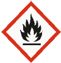
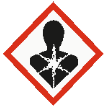
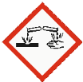
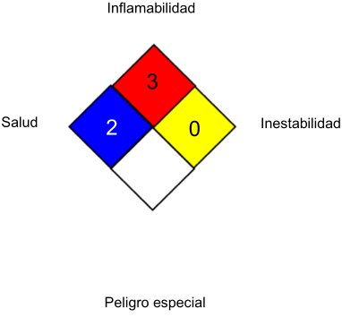
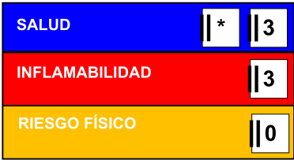

<!-- doc_id: fds072-sikafloor-2430-co-comp-b-sika -->
<!-- archivo_original: FDS 72 - Sikafloor#U00ae-2430 CO Comp.B - SIKA.pdf -->

<!-- pagina: 1 -->
## FICHA DE DATOS DE SEGURIDAD

## Sikafloor®-2430 Part B

Versión 3.0

Número de HDS: 100000030203

Fecha de revisión: 2023/08/15

## SECCIÓN 1. IDENTIFICACIÓN DE LA SUSTANCIA QUÍMICA PELIGROSA O MEZCLA Y DEL PROVEEDOR O FABRICANTE

Nombre del producto

: Sikafloor®-2430 Part B

## Informaciones sobre el fabricante o el proveedor

Compañía

Teléfono

: Sika Colombia S.A.S. Vereda Canavita km 20,5 Autopista Norte Tocancipá, Cundinamarca Colombia

: (57-1) 8786333

Teléfono de emergencia

Dirección de correo electróni-

co

Fax

: CISPROQUIM Bogotá: 2886012 / 2886355 Resto del país: 01 8000 916012

: controlcalidad.lab@co.sika.com

: (57-1) 8786660

## Uso recomendado del producto químico y restricciones de uso

Uso del producto

: Catalizador

## SECCIÓN 2. IDENTIFICACIÓN DE LOS PELIGROS

## Clasificación según SGA (GHS)

Líquidos Inflamables

Toxicidad aguda (Inhalación)

: Categoría 3

: Categoría 4

Toxicidad aguda (Cutáneo)

: Categoría 4

Corrosión/irritación cutáneas : Categoría 2

Lesiones oculares gra-

ves/irritación ocular

Toxicidad sistémica específica de órganos blanco - exposición única

Toxicidad sistémica específica de órganos blanco - Exposiciones repetidas (Inhalación)

Peligro a corto plazo (agudo) para el medio ambiente acuático

: Categoría 1

: Categoría 3 (Sistema respiratorio)

: Categoría 2

: Categoría 2

Peligro a largo plazo (crónico) : Categoría 3

<!-- pagina: 2 -->
## FICHA DE DATOS DE SEGURIDAD

## Sikafloor®-2430 Part B

Versión 3.0

Número de HDS: 100000030203

Fecha de revisión: 2023/08/15

para el medio ambiente acuático

## Etiqueta SGA (GHS)

Pictogramas de peligro :

Palabra de advertencia

: Peligro

Indicaciones de peligro

: H226 Líquido y vapores inflamables.

Consejos de prudencia H312 + H332 Nocivo en contacto con la piel o si se inhala.

H315 Provoca irritación cutánea.

H318 Provoca lesiones oculares graves.

H335 Puede irritar las vías respiratorias.

H373 Puede provocar daños en los órganos tras exposiciones prolongadas o repetidas por inhalación.

H401 Tóxico para los organismos acuáticos.

H412 Nocivo para los organismos acuáticos, con efectos nocivos duraderos.

: Prevención:

P210 Mantener alejado del calor, chispas, llamas al descubierto, superficies calientes y otras fuentes de ignición. No fumar. P233 Mantener el recipiente herméticamente cerrado.

P240 Toma de tierra y enlace equipotencial del recipiente y del equipo receptor.

P241 Utilizar material eléctrico, de ventilación o de iluminación/ antideflagrante.

P242 No utilizar herramientas que produzcan chispas.

P243 Tomar medidas de precaución contra las descargas electrostáticas.

P260 No respirar nieblas o vapores.

P264 Lavarse la piel cuidadosamente después de la manipulación.

P271 Utilizar sólo al aire libre o en un lugar bien ventilado.

P273 No dispersar en el medio ambiente.

P280 Usar guantes/ ropa de protección/ equipo de protección para los ojos/ la cara.

## Intervención:

P303 + P361 + P353 EN CASO DE CONTACTO CON LA PIEL (o el pelo): Quitar inmediatamente toda la ropa contaminada. Enjuagar la piel con agua.

P304 + P340 + P312 EN CASO DE INHALACIÓN: Transportar a la persona al aire libre y mantenerla en una posición que le facilite la respiración.Llamar a un CENTRO DE

TOXICOLOGÍA/médico/ si la persona se encuentra mal. P305 + P351 + P338 + P310 EN CASO DE CONTACTO CON LOS OJOS: Enjuagar con agua cuidadosamente durante varios minutos. Quitar las lentes de contacto cuando estén presentes y pueda hacerse con facilidad. Proseguir con el lavado. Llamar inmediatamente a un CENTRO DE TOXICOLOGÍA o a un médico.

P314 Consultar a un médico si la persona se encuentra mal.

<!-- pagina: 3 -->
## FICHA DE DATOS DE SEGURIDAD

## Sikafloor®-2430 Part B

Versión 3.0

Número de HDS: 100000030203

Fecha de revisión: 2023/08/15

## Otros peligros no clasificables

No conocidos.

P332 + P313 En caso de irritación cutánea: consultar a un médico.

P362 + P364 Quitar la ropa contaminada y lavarla antes de volverla a usar.

P370 + P378 En caso de incendio: Utilizar arena seca, producto químico seco o espuma resistente al alcohol para la extinción.

## Almacenamiento:

P403 + P233 Almacenar en un lugar bien ventilado. Mantener el recipiente herméticamente cerrado.

P403 + P235 Almacenar en un lugar bien ventilado. Mantener fresco.

P405 Guardar bajo llave.

## Eliminación:

P501 Eliminar el contenido/ recipiente en una planta de eliminación de residuos aprobada.

## SECCIÓN 3. COMPOSICIÓN/INFORMACIÓN SOBRE LOS INGREDIENTES

Sustancia / mezcla

: Mezcla

## Componentes

| Nombre químico     | CAS No.     | Concentración (% w/w)   |
|--------------------|-------------|-------------------------|
| xileno             | 1330-20-7   | >= 50 - < 70            |
| Poliaminoamida     | No asignado | >= 10 - < 20            |
| etilbenceno        | 100-41-4    | >= 10 - < 20            |
| 2-metilpropan-1-ol | 78-83-1     | >= 5 - < 10             |

## SECCIÓN 4. PRIMEROS AUXILIOS

Consejos generales

En caso de inhalación

: Retire a la persona de la zona peligrosa.

Consulte a un médico.

Muéstrele esta hoja de seguridad al doctor que esté de servicio.

: Salga al aire libre.

En caso de contacto con la piel Consultar a un médico después de una exposición importante.

: Quítese inmediatamente la ropa y zapatos contaminados. Elimínelo lavando con jabón y mucha agua. Si persisten los síntomas, llame a un médico.

En caso de contacto con los ojos :

Incluso pequeñas salpicaduras en los ojos pueden causar daños irreversibles en los tejidos y ceguera.

En caso de contacto con los ojos, lávelos inmediata y abundantemente con agua y acuda a un médico.

Continúe lavando los ojos en el trayecto al hospital.

Quítese los lentes de contacto.

Manténgase el ojo bien abierto mientras se lava.

<!-- pagina: 4 -->
## FICHA DE DATOS DE SEGURIDAD

## Sikafloor®-2430 Part B

Versión 3.0

Número de HDS: 100000030203

Fecha de revisión: 2023/08/15

En caso de ingestión

Síntomas y efectos más importante, agudos y retardados

Notas especiales para un medico tratante

: Lávese la boca con agua y después beba agua abundante.

No dé leche ni bebidas alcohólicas. Nunca debe administrarse nada por la boca a una persona inconsciente. Consulte al médico.

: Nocivo en contacto con la piel o si se inhala. Provoca irritación cutánea. Provoca lesiones oculares graves. Puede irritar las vías respiratorias. Puede provocar daños en los órganos tras exposiciones prolongadas o repetidas por inhalación. efectos irritantes

Tos

Desordenes respiratorios

Lacrimación excesiva

Dolor de cabeza

Dermatitis

Trastornos cutáneos

Vea la Sección 11 para obtener información detallada sobre la salud y los síntomas.

: Trate sintomáticamente.

## SECCIÓN 5. MEDIDAS CONTRA INCENDIOS

Medios de extinción apropiados

Agentes de extinción inapropiados

Peligros específicos durante la extincion de incendios

: Espuma resistente a los alcoholes

Dióxido de carbono (CO2) Producto químico seco

: Agua

Chorro de agua de gran volumen

: No use un chorro compacto de agua ya que puede dispersar y extender el fuego.

Productos de combustión peligrosos

Métodos específicos de extinción

Equipo de protección especial para los bomberos

: No se conocen productos de combustión peligrosos

: Utilice rocío de agua para enfriar los recipientes cerrados.

: En caso de incendio, utilice un equipo respiratorio autónomo.

## SECCIÓN 6. MEDIDAS QUE DEBEN TOMARSE EN CASO DE DERRAME ACCIDENTAL O FUGA ACCIDENTAL

Precauciones personales,

equipo de protección y procedimientos de emergencia

Precauciones relativas al

: Utilice equipo de protección personal.

Retire todas las fuentes de ignición. Negar el acceso a personas sin protección.

: Evite que el producto vaya al alcantarillado.

<!-- pagina: 5 -->
## FICHA DE DATOS DE SEGURIDAD

## Sikafloor®-2430 Part B

| Versión 3.0                                   | Número de HDS: 100000030203   | Fecha de revisión: 2023/08/15                                                                                                                                                                                                                               |
|-----------------------------------------------|-------------------------------|-------------------------------------------------------------------------------------------------------------------------------------------------------------------------------------------------------------------------------------------------------------|
| medio ambiente                                |                               | Si el producto contamina los ríos, lagos o alcantarillados, in- formar a las autoridades respectivas.                                                                                                                                                       |
| Métodos y materiales de contención y limpieza | :                             | Contener y recoger el derrame con material absorbente que no sea combustible (p. ej. arena, tierra, barro de diatomeas, vermiculita), y meterlo en un envase para su eliminación de acuerdo con las reglamentaciones locales y nacionales (ver sección 13). |

## SECCIÓN 7. MANEJO Y ALMACENAMIENTO

| Sugerencias para la protec- ción contra incendios y ex- plosiones   | :   | Utilice un equipo a prueba de explosiones. Mantener alejado del calor/ de chispas/ de llamas al descu- bierto/ de superficies calientes. No fumar. Tomar medidas de precaución contra la acumulación de car- gas electrostáticas.                                                                                                                                                                                                                                                                                                                                                                                                                                                                                                                                                    |
|---------------------------------------------------------------------|-----|--------------------------------------------------------------------------------------------------------------------------------------------------------------------------------------------------------------------------------------------------------------------------------------------------------------------------------------------------------------------------------------------------------------------------------------------------------------------------------------------------------------------------------------------------------------------------------------------------------------------------------------------------------------------------------------------------------------------------------------------------------------------------------------|
| Consejos para una manipu- lación segura                             | :   | No respire los vapores ni la niebla de la pulverización. Evitar sobrepasar los límites dados de exposición profesional (ver sección 8). Evitar todo contacto con los ojos, la piel o la ropa. Ver sección 8 para el equipo de protección personal. Fumar, comer y beber debe prohibirse en el área de aplica- ción. Tomar medidas de precaución contra las descargas electros- táticas. Provea de suficiente intercambio de aire y/o de extracción en los lugares de trabajo. Abra el tambor con precaución, ya que el contenido puede estar presurizado. Adopte las acciones necesarias para evitar descargas de electricidad estática (que podrían ocasionar la inflamación de los vapores orgánicos). Cuando se manejen productos químicos, siga las medidas estándar de higiene. |
| Condiciones para el almace- namiento seguro                         | :   | Almacénelo en el envase original. Mantenga en un lugar bien ventilado. Los contenedores que se abren deben ser cuidadosamente resellados y mantenerlos en posición vertical para evitar fu- gas. Observar las indicaciones de la etiqueta. Almacenar en conformidad con la reglamentación local.                                                                                                                                                                                                                                                                                                                                                                                                                                                                                     |

## SECCIÓN 8. CONTROLES DE EXPOSICIÓN/PROTECCIÓN PERSONAL

## Componentes con parámetros de control en el área de trabajo

| Componentes        | CAS No.   | Tipo de valor (Forma de exposición)   | Parámetros de control / Concen- tración permisible   | Bases   |
|--------------------|-----------|---------------------------------------|------------------------------------------------------|---------|
| xileno             | 1330-20-7 | TWA                                   | 20 ppm                                               | ACGIH   |
| etilbenceno        | 100-41-4  | TWA                                   | 20 ppm                                               | ACGIH   |
| 2-metilpropan-1-ol | 78-83-1   | TWA                                   | 50 ppm                                               | ACGIH   |

<!-- pagina: 6 -->
## FICHA DE DATOS DE SEGURIDAD

## Sikafloor®-2430 Part B

Versión 3.0

Número de HDS: 100000030203

Fecha de revisión: 2023/08/15

## Límites biológicos de exposición ocupacional

| Componentes   | CAS No.   | Parámetros de control                                   | Análisis biológico   | Tiempo de toma de mues- tras                                                         | Concentra- ción permisi- ble   | Bases     |
|---------------|-----------|---------------------------------------------------------|----------------------|--------------------------------------------------------------------------------------|--------------------------------|-----------|
| xileno        | 1330-20-7 | Acidos me- tilhipúricos                                 | Orina                | Al final del turno (Tan pronto como sea posible después de que cese la exposi- ción) | 1.5 g/g crea- tinina           | ACGIH BEI |
| etilbenceno   | 100-41-4  | Suma del ácido man- délico y el ácido fenil- glioxílico | Orina                | Al final del turno (Tan pronto como sea posible después de que cese la exposi- ción) | 0.15 g/g creatinina            | ACGIH BEI |

## Protección personal

| Protección respiratoria            | :   | Utilice protección respiratoria a menos que exista una venti- lación de escape adecuada o que la evaluación de la exposi- ción indique que el nivel de exposición está dentro de las pautas recomendadas. La clase de filtro para el respirador debe ser adecuada para la concentración máxima prevista del contaminante (gas/vapor/aerosol/partículas) que puede presentarse al ma- nejar el producto. Si se excede esta concentración, se debe utilizar un aparato respiratorio autónomo.   |
|------------------------------------|-----|-----------------------------------------------------------------------------------------------------------------------------------------------------------------------------------------------------------------------------------------------------------------------------------------------------------------------------------------------------------------------------------------------------------------------------------------------------------------------------------------------|
| Protección de las manos            | :   | Guantes químico-resistentes e impermeables que cumplan con estándares aprobados deben ser utilizados cuando se manejen productos químicos y la evaluación del riesgo indica que es necesario.                                                                                                                                                                                                                                                                                                 |
| Protección de los ojos             | :   | Equipo de protección ocular que cumpla con estándares aprobados debe ser utilizado cuando la evaluación del riesgo indica que es necesario.                                                                                                                                                                                                                                                                                                                                                   |
| Protección de la piel y del cuerpo | :   | Elegir la protección para el cuerpo según sus caraterísticas, la concentración y la cantidad de sustancias peligrosas, y el lugar específico de trabajo.                                                                                                                                                                                                                                                                                                                                      |
| Medidas de higiene                 | :   | Manipúlelo con las precauciones de higiene industrial ade- cuadas, y respete las prácticas de seguridad. No coma ni beba durante su utilización. No fume durante su utilización. Lavarse las manos antes de los descansos y después de                                                                                                                                                                                                                                                        |

<!-- pagina: 7 -->
## Sikafloor®-2430 Part B

Versión 3.0

Número de HDS: 100000030203

Fecha de revisión: 2023/08/15

terminar la jornada laboral.

## SECCIÓN 9. PROPIEDADES FÍSICAS Y QUÍMICAS

Aspecto :

Color líquido

: varios

Olor

: característico

Umbral de olor

: Sin datos disponibles

pH

: 8

Punto de fusión/rango / Punto

de congelación

Punto / intervalo de ebullición : Sin datos disponibles

Punto de inflamación

: 28 °C (28 °C)

Tasa de evaporación

: Sin datos disponibles

Inflamabilidad (sólido, gas)

: Sin datos disponibles

Límite superior de explosividad / Límite de inflamabilidad superior

Límite inferior de explosividad

/ Límite de inflamabilidad infe-

rior

Presión de vapor

: 6,2 %(V)

: 1 %(V)

: 11,9999 hPa

Densidad relativa de vapor

: Sin datos disponibles

Densidad

: aprox. 1,5 g/cm3 (20 °C (20 °C))

Solubilidad

Hidrosolubilidad :

insoluble

Solubilidad en otros disolventes

Coeficiente de reparto n-

octanol/agua

Temperatura de ignición es-

pontánea

Temperatura de descomposi-

ción

Viscosidad

Viscosidad, dinámica

: Sin datos disponibles

: Sin datos disponibles

: 415 °C

: Sin datos disponibles

: Sin datos disponibles

Viscosidad, cinemática

: &gt; 20,5 mm2/s ( 40 °C (40 °C))

Propiedades explosivas

: Sin datos disponibles

: Sin datos disponibles

<!-- pagina: 8 -->
## FICHA DE DATOS DE SEGURIDAD

## Sikafloor®-2430 Part B

Versión 3.0

Número de HDS: 100000030203

Fecha de revisión: 2023/08/15

Propiedades comburentes

: Sin datos disponibles

## SECCIÓN 10. ESTABILIDAD Y REACTIVIDAD

Reactividad

Estabilidad química

: No se conoce ninguna reacción peligrosa bajo condiciones de uso normal.

: El producto es químicamente estable.

Posibilidad de reacciones peligrosas

: Estable bajo las condiciones de almacenamiento recomendadas.

Condiciones que deben evi-

tarse

Materiales incompatibles Los vapores pueden formar una mezcla explosiva con el aire.

: Calor, llamas y chispas.

: Sin datos disponibles

## SECCIÓN 11. INFORMACIÓN TOXICOLÓGICA

## Toxicidad aguda

Nocivo en contacto con la piel o si se inhala.

## Componentes:

## xileno:

Toxicidad oral aguda

: DL50 Oral (Rata): 3.523 mg/kg

## etilbenceno:

Toxicidad oral aguda

: DL50 Oral (Rata): 3.500 mg/kg

Toxicidad dérmica aguda

: LD50 Dermico (Conejo): 5.510 mg/kg

## Corrosión o irritación cutáneas

Provoca irritación cutánea.

## Lesiones oculares graves/irritación ocular

Provoca lesiones oculares graves.

## Sensibilización respiratoria o cutánea

## Sensibilización cutánea

No se clasifica debido a la falta de datos.

## Sensibilización respiratoria

No se clasifica debido a la falta de datos.

## Mutagenicidad en células germinales

No se clasifica debido a la falta de datos.

## Carcinogenicidad

No se clasifica debido a la falta de datos.

## Toxicidad para la reproducción

No se clasifica debido a la falta de datos.

<!-- pagina: 9 -->
## FICHA DE DATOS DE SEGURIDAD

## Sikafloor®-2430 Part B

Versión 3.0

Número de HDS: 100000030203

Fecha de revisión: 2023/08/15

## Toxicidad sistémica específica de órganos blanco - exposición única

Puede irritar las vías respiratorias.

## Toxicidad sistémica específica de órganos blanco - exposiciones repetidas

Puede provocar daños en los órganos tras exposiciones prolongadas o repetidas por inhalación.

## Toxicidad por aspiración

No se clasifica debido a la falta de datos.

## SECCIÓN 12. INFORMACIÓN ECOTOXICOLOGICA

## Ecotoxicidad

## Componentes:

## xileno:

Toxicidad para peces (Toxi-

cidad crónica)

Toxicidad para la dafnia y

otros invertebrados acuáticos

(Toxicidad crónica)

: NOEC (Oncorhynchus mykiss (trucha irisada)): &gt; 1,3 mg/l

Tiempo de exposición: 56 d

: NOEC (Daphnia (Dafnia)): 1,17 mg/l

Tiempo de exposición: 7 d

## Persistencia y degradabilidad

Sin datos disponibles

## Potencial de bioacumulación

Sin datos disponibles

## Movilidad en el suelo

Sin datos disponibles

## Otros efectos adversos

## Producto:

Información ecológica com-

plementaria

: No se puede excluir un peligro para el medio ambiente en el caso de una manipulación o eliminación no profesional. Nocivo para los organismos acuáticos, con efectos nocivos duraderos.

## SECCIÓN 13. INFORMACIÓN RELATIVA A LA ELIMINACIÓN DE LOS PRODUCTOS

## Métodos de eliminación

Residuos

Envases contaminados

: Envíese a una compañía autorizada para la gestión de residuos.

Evite que el producto penetre en los desagües, tuberías, o la tierra (suelos).

No contamine los estanques, cursos de agua o zanjas con el producto químico o el contendor utilizado.

: Vacíe el contenido restante.

Eliminar como producto no usado.

No reutilice los recipientes vacíos. No queme, ni utilice un soplete de corte, en el tambor vacío.

<!-- pagina: 10 -->
## FICHA DE DATOS DE SEGURIDAD

## Sikafloor®-2430 Part B

Versión 3.0

Número de HDS: 100000030203

Fecha de revisión: 2023/08/15

## SECCIÓN 14. INFORMACIÓN RELATIVA AL TRANSPORTE

## Regulaciones internacionales

## UNRTDG

Número ONU

: UN 1263

Designación oficial de trans-

porte

Clase

: PAINT RELATED MATERIAL

: 3

Grupo de embalaje :

III

Etiquetas

: 3

## IATA-DGR

No. UN/ID

: UN 1263

Designación oficial de trans-

porte

Clase

: Paint related material

: 3

Grupo de embalaje :

III

Etiquetas

: Flammable Liquids

Instrucción de embalaje

(avión de carga)

Instrucción de embalaje

(avión de pasajeros)

## Código-IMDG

Número ONU

: UN 1263

Designación oficial de trans-

porte

Clase

: PAINT RELATED MATERIAL

: 3

Grupo de embalaje :

III

Etiquetas

: 3

Código EmS

: F-E, S-E

Contaminante marino

: no

## Transporte a granel de acuerdo a instrumentos IMO

No aplicable para el producto tal y como se proveyó.

## Precauciones especiales para los usuarios

La(s) clasificación(es) de transporte presente(s) tienen solamente propósitos informativos y se basa(n) únicamente en las propiedades del material sin envasar/embalar, descritas dentro de esta Hoja de Datos de Seguridad. Las clasificaciones de transporte pueden variar según el modo de transporte, el tamaño del envase/embalaje y las variaciones en los reglamentos regionales o del país.

## SECCIÓN 15. INFORMACIÓN REGLAMENTARIA

## Reglamentación medioambiental, seguridad y salud específica para la sustancia o mezcla

Convención Internacional sobre las Armas Químicas

(CWC) Programas sobre los Productos Químicos Tó-

xicos y los Precursores (Louisiana Administrative Co-

de, Title 33,Part V Section 10101 et. seq.)

Sustancias y productos químicos controlados por el

Ministerio de Justicia

Listado de Sustancias incluídas como Sustancias de

Control Especial y Sometidas a Fiscalización por el

Ministerio de Salud y Protección Social

: No aplicable

: xileno

2-metilpropan-1-ol

: No aplicable

: 366

: 355

<!-- pagina: 11 -->
## FICHA DE DATOS DE SEGURIDAD

## Sikafloor®-2430 Part B

Versión 3.0

Número de HDS: 100000030203

Fecha de revisión: 2023/08/15

Resolución 2715 de 2014 Por la cual se establecen las

sustancias que deben ser objeto de registro de control

de venta al menudeo, con base en los criterios de clasificación que se definen.

: No aplicable

## SECCIÓN 16. OTRA INFORMACIÓN INCLUIDAS LAS RELATIVAS A LA PREPARACIÓN Y ACTUALIZACIÓN DE LAS HOJAS DE DATOS DE SEGURIDAD

Fecha de revisión

formato de fecha

: 2023/08/15

: aaaa/mm/dd

## Información adicional

## NFPA:

## HMIS® IV:

## Texto completo de otras abreviaturas

ACGIH

ACGIH BEI

: Valores límite (TLV) de la ACGIH,USA

: ACGIH - Índices Biológicos de Exposición (BEI)

ACGIH / TWA

: Tiempo promedio ponderado

ADR

: Accord européen relatif au transport international des mar-

CAS

chandises Dangereuses par Route

: Chemical Abstracts Service

DNEL

: Derived no-effect level

EC50

: Half maximal effective concentration

GHS

: Globally Harmonized System

IATA :

International Air Transport Association

IMDG

:

International Maritime Code for Dangerous Goods

LD50

LC50

: Median lethal dosis (the amount of a material, given all at once, which causes the death of 50% (one half) of a group of test animals)

: Median lethal concentration (concentrations of the chemical in air that kills 50% of the test animals during the observation period)

MARPOL :

International Convention for the Prevention of Pollution from Ships, 1973 as modified by the Protocol of 1978

Las clasificaciones HMIS® se basan en una escala del 0 al 4 en la que 0 significa riesgos o peligros mínimos y 4 significa riesgos o peligros serios. El "*" representa un peligro crónico, mientras que la "/" representa la ausencia de un peligro crónico.

<!-- pagina: 12 -->
## FICHA DE DATOS DE SEGURIDAD

## Sikafloor®-2430 Part B

| Versión 3.0   | Número de HDS: 100000030203                                                                                                                                                         | Fecha de revisión: 2023/08/15                                                                                                                                                       |
|---------------|-------------------------------------------------------------------------------------------------------------------------------------------------------------------------------------|-------------------------------------------------------------------------------------------------------------------------------------------------------------------------------------|
| OEL           | : Occupational Exposure Limit :                                                                                                                                                     |                                                                                                                                                                                     |
| PBT           | Persistent, bioaccumulative and toxic                                                                                                                                               |                                                                                                                                                                                     |
| PNEC          | : Predicted no effect concentration                                                                                                                                                 |                                                                                                                                                                                     |
| REACH         | : Regulation (EC) No 1907/2006 of the European Parliament and of the Council of 18 December 2006 concerning the Re- gistration, Evaluation, Authorisation and Restriction of Chemi- | : Regulation (EC) No 1907/2006 of the European Parliament and of the Council of 18 December 2006 concerning the Re- gistration, Evaluation, Authorisation and Restriction of Chemi- |
| SVHC          | cals (REACH), establishing a European : Substances of Very High Concern                                                                                                             | Chemicals Agency                                                                                                                                                                    |
| vPvB          | : Very persistent and very bioaccumulative                                                                                                                                          |                                                                                                                                                                                     |

La informacion contenida en este ficha de datos de seguridad corresponde a nuestro nivel de conocimiento en el momento de su publicacion. Quedan excluidas todas las garantias. Se aplicaran nuestras condiciones generales de venta en vigor. Por favor, consulte la Hoja de Datos del Producto antes de su uso y procesamiento. CO / 1X
