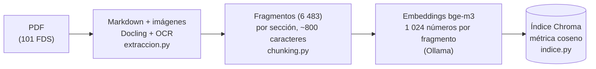
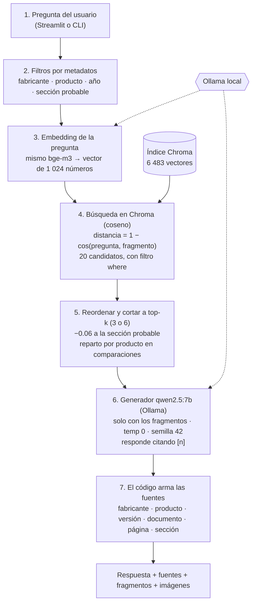

# Diagramas: cómo funciona la aplicación

GitHub dibuja estos diagramas directamente (Mermaid). Detalle de parámetros en [`rag_diseno.md`](rag_diseno.md).

## 1. Preparación (se hace una sola vez)



## 2. Qué pasa con cada pregunta

`rag.responder()` (en `src/rag_fds/rag.py`) orquesta todo; `app/demo.py` (Streamlit) solo lo llama. Ollama es el servidor local que atiende los dos modelos.



Para evaluar, `evaluacion.py` llama la misma función `responder()` y RAGAS puntúa con `llama3.1:8b` (evaluador distinto del generador).

## 3. La fórmula de la búsqueda

Un embedding es un vector de 1 024 números que representa el significado de un texto. Se compara la pregunta con cada fragmento por la **similitud coseno**:

```
cos(a, b) = (a · b) / (‖a‖ · ‖b‖)        distancia = 1 − cos(a, b)
```

Distancia menor = fragmento más parecido. Se devuelven los `k` más cercanos (3 o 6, lo único que cambia entre `topk3.yaml` y `topk6.yaml`).

Ejemplo mínimo con vectores de 2 números: pregunta = (1, 0); fragmento A = (0.9, 0.1) → cos ≈ 0.99, distancia ≈ 0.01; fragmento B = (0, 1) → cos = 0, distancia = 1. Gana A.

Notas:
- Pregunta y fragmentos se embeben con el **mismo modelo**; si no, no viven en el mismo espacio.
- Chroma usa un índice aproximado (HNSW, grafo de vecinos cercanos) en lugar de comparar contra los 6 483 vectores uno por uno.
- La búsqueda siempre devuelve algo, aunque no sea relevante; por eso el prompt obliga a responder «No hay evidencia suficiente…» cuando los fragmentos no contestan.
